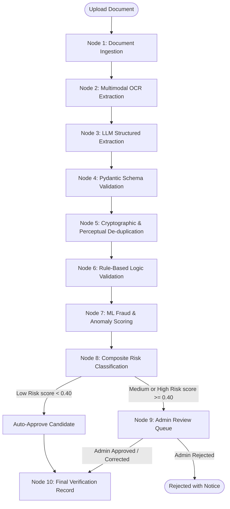
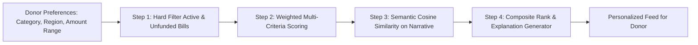

# AI/ML & Intelligent Agent Architecture
## Project Name: BillKind AI
### AI-Powered Essential Bills Crowdfunding & Financial Assistance Platform
**Document Version:** 1.0.0  
**Status:** Approved for Implementation (Phase 1 Deliverable)  
**Date:** November 2026  

---

## 1. AI Pipeline Overview

The intelligence tier of BillKind AI is designed with three core guiding principles:
1. **Explainability & Human Agency:** Machine learning and generative models serve as cognitive accelerators and fraud screeners, but critical decisions (approving or rejecting high-risk assistance) remain with human administrators.
2. **Deterministic Schemas over Freeform Text:** All LLM inputs and outputs pass through strictly typed Pydantic models with automated schema repairs and fallback parsers.
3. **Stateful Graph Workflows:** Complex multistep verifications are orchestrated using **LangGraph**, providing checkpointing, conditional branching, and error recovery.



---

## 2. LangGraph Verification State Machine

The verification workflow is modeled as a state graph (`VerificationState`) containing:
- `bill_id`: UUID of the bill request.
- `raw_text`: Extracted document OCR string.
- `extracted_data`: Validated `ExtractedBillDataSchema`.
- `rule_flags`: Dictionary of boolean rule violations.
- `ml_anomaly_score`: Float between 0.0 and 1.0.
- `risk_score`: Weighted composite score.
- `risk_level`: `'low'`, `'medium'`, or `'high'`.
- `requires_human_review`: Boolean trigger.
- `audit_trail`: Chronological state logs.

### 2.1 The Ten Graph Nodes
1. **`document_ingestion`:** Loads file from private object storage, inspects MIME headers, generates SHA-256 and `pHash`.
2. **`ocr_extraction`:** Runs PyMuPDF or cloud OCR (Textract/Document AI) to extract text coordinates and raw body.
3. **`llm_field_extraction`:** Passes text to Gemini/OpenAI using an extraction prompt template bound to Pydantic structured output.
4. **`schema_validation`:** Asserts type safety, parses dates (`YYYY-MM-DD`), normalizes currencies, and validates confidence scores.
5. **`duplicate_detection`:** Queries database for identical SHA-256 hashes, similar `pHash` within Hamming distance ≤ 5, and duplicate provider invoice numbers.
6. **`rule_based_validation`:** Flags discrepancies between user-declared amount and extracted amount (> 5% deviation), invalid due dates (past or > 180 days in future), or known fraudulent provider patterns.
7. **`ml_fraud_scoring`:** Feeds feature vector into Isolation Forest (unsupervised outlier detection) and XGBoost/Random Forest (supervised fraud classifier).
8. **`risk_classification`:** Computes weighted composite risk:
   $$\text{RiskScore} = 0.40 \times \text{RuleScore} + 0.35 \times \text{MLScore} + 0.15 \times \text{SimilarityScore} + 0.10 \times (1 - \text{Confidence})$$
9. **`human_review_routing`:** If $\text{RiskScore} \ge 0.40$, places bill into the admin triage queue with specific explainability highlights. Suspends automated progression until human sign-off.
10. **`final_verification_status`:** Writes decision record to PostgreSQL, transitions `bill_requests.verification_status` to `verified`, and emits real-time WebSocket/notification events.

---

## 3. Hybrid AI/ML Fraud Detection Engine

### 3.1 Model Architecture & Ensemble
The fraud engine combines three complementary detection paradigms:

| Tier | Technique | Primary Target |
| :--- | :--- | :--- |
| **Tier 1: Deterministic Rules** | Boolean rule predicates | Impossible dates, over-requesting, exact duplicate invoice numbers, mismatch > 10% |
| **Tier 2: Computer Vision & Perceptual Hashing** | Image Difference, Hamming Distance on `pHash` | Edited numbers, spliced digital text, re-uploaded modified copies |
| **Tier 3: Machine Learning Ensemble** | Isolation Forest + XGBoost / Scikit-learn Classifier | Abnormal amount-to-category ratios, burst submission velocity, anomaly patterns |

### 3.2 Feature Vector Schema
- `feature_amount_ratio`: `requested_amount / category_median_amount`
- `feature_amount_mismatch_pct`: `abs(user_amount - extracted_amount) / extracted_amount`
- `feature_days_until_due`: `due_date - today`
- `feature_ocr_confidence`: Average OCR token confidence score
- `feature_extraction_confidence`: LLM extraction confidence metric
- `feature_user_submission_count_7d`: Beneficiary submissions in the last 7 days
- `feature_phash_min_distance`: Minimum Hamming distance to any existing document

### 3.3 Evaluation Metrics & Thresholds
- **Precision (Fraud Class):** $\ge 88\%$ (minimize false accusations)
- **Recall (Fraud Class):** $\ge 92\%$ (capture true fraudulent attempts)
- **False Positive Rate (FPR):** $\le 5\%$
- **Policy Guardrail:** High risk *never* triggers automatic rejection. Requests are strictly routed to human officers.

---

## 4. Intelligent Donor Matching & Recommendation Engine



### 4.1 Hybrid Scoring Formula
Each candidate bill $i$ is scored for donor $j$ using:
$$\text{Score}(i, j) = 0.35 \times C_{\text{match}} + 0.25 \times L_{\text{match}} + 0.20 \times U_{\text{score}} + 0.20 \times \text{CosineSim}(\mathbf{e}_j, \mathbf{e}_i)$$

Where:
- $C_{\text{match}} \in \{0, 1\}$: Exact match with donor preferred categories.
- $L_{\text{match}} \in \{0, 0.5, 1.0\}$: Geographic affinity (exact city = 1.0, same state = 0.5, other = 0).
- $U_{\text{score}} = \exp\left(-\frac{\text{days\_to\_due}}{7}\right)$: Exponential urgency decay giving higher weight to bills facing imminent utility shutoff.
- $\mathbf{e}_i$: 384-dimensional dense embedding generated by `sentence-transformers/all-MiniLM-L6-v2` encoding the bill hardship narrative.
- $\mathbf{e}_j$: Semantic profile embedding of donor cause interests.

### 4.2 Explainable Recommendations
For every recommended card, the system produces a contextual rationale:
> *"Recommended because you previously funded education bills in Andhra Pradesh and this student's tuition is due in 3 days."*

---

## 5. RAG-Based Policy Assistant Chatbot

### 5.1 Document Ingestion & Chunking
- **Corpus:** Platform eligibility guidelines, disbursement workflows, KYC compliance policies, refund terms, and 80G tax rules.
- **Chunking Strategy:** Recursive character chunking (size = 400 tokens, overlap = 50 tokens) with Markdown header preservation.
- **Vector Index:** PostgreSQL with `pgvector` indexed via HNSW on cosine operator (`vector_cosine_ops`).

### 5.2 Retrieval & Generation Flow
1. User submits natural language query.
2. Query is converted to vector embedding via Sentence Transformers.
3. Top $k=3$ relevant policy passages are retrieved from `document_embeddings`.
4. Passages are injected into a strict system prompt template:
   ```
   You are the BillKind AI Policy Guide. Answer the user query strictly using the provided policy excerpts.
   If the answer cannot be determined from the excerpts, respond: 'I do not have authoritative information on that policy topic; please contact support@billkind.ai.'
   Never approve bills, promise payments, or execute financial mutations.
   Always cite the policy document title and section number.
   ```
5. Grounded response with interactive citation pills is streamed to the user.

---
*End of AI/ML Implementation Strategy*
