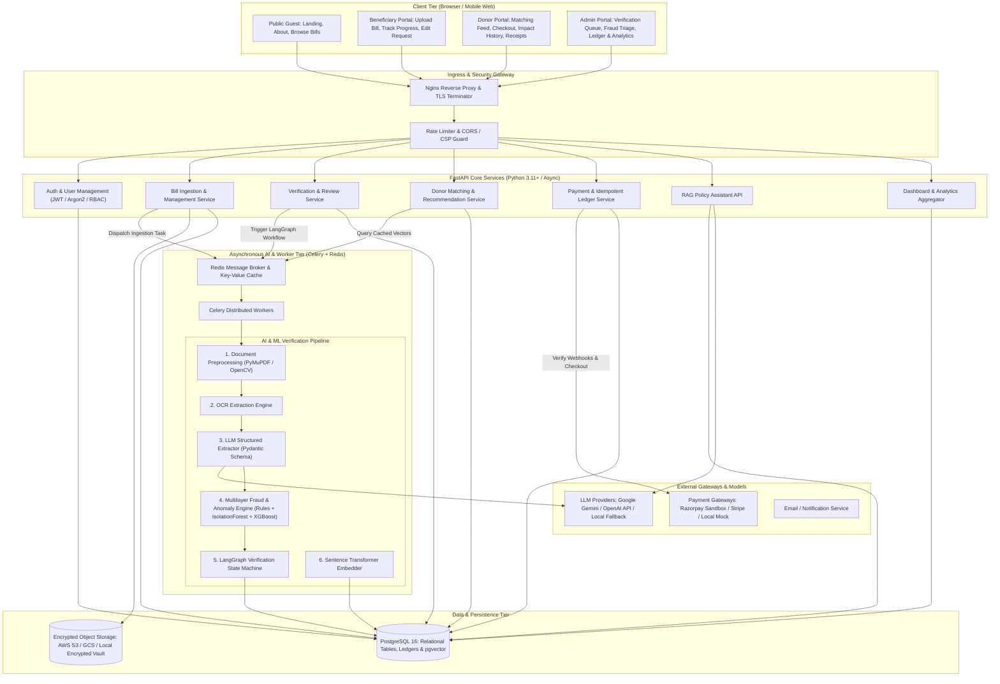
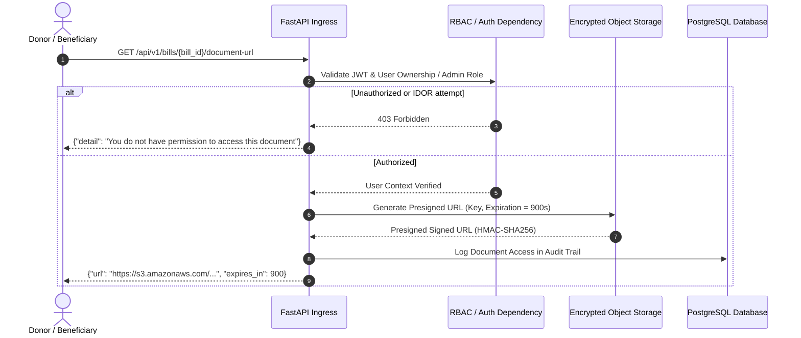

# System Architecture Specification
## Project Name: BillKind AI
### AI-Powered Essential Bills Crowdfunding & Financial Assistance Platform
**Document Version:** 1.0.0  
**Status:** Approved for Implementation (Phase 1 Deliverable)  
**Date:** November 2026  

---

## 1. Architectural Overview & Design Principles

BillKind AI is architected as a high-performance, resilient, and secure modular monolith with dedicated asynchronous worker queues. This pattern optimizes operational simplicity and transaction atomicity while providing elastic horizontal scaling for computationally intensive AI, OCR, and ML tasks.

### Key Architectural Tenets
1. **Separation of Concerns:** Clean layered architecture with distinct presentation (React/Vite), API gateway / ingress (Nginx), application core (FastAPI), domain repositories (SQLAlchemy 2.0 Async), worker tasks (Celery/Redis), and intelligence layer (LangChain/LangGraph/Scikit-learn/XGBoost).
2. **Zero-Trust Private Document Access:** Bill documents are treated as confidential, untrusted data. Documents are stored in isolated private object storage, accessed only via short-lived cryptographically signed URLs after strict authorization checks.
3. **Pessimistic Concurrency for Financial State:** Crowdfunding requires absolute prevention of overfunding and duplicate credits. Database row-level locks (`SELECT FOR UPDATE`) protect bill funding balances during checkout and webhook fulfillment.
4. **Resilient AI Pipeline with Human-in-the-Loop:** Automated AI extractions and fraud scores guide, but never unilaterally reject, applicants. The LangGraph state machine handles retries, checkpoints, and automated escalation to human administrators.
5. **Provider Agnostic Abstractions:** Payment processing (Razorpay, Stripe, Mock) and Object Storage (S3, GCS, Local File System) are implemented behind standard Python protocol interfaces, enabling instant local development without third-party credentials.

---

## 2. Mermaid System Architecture Diagram

---

## 3. Network Topology & Deployment Zones

### 3.1 Trust Zones
1. **Public Zone (Internet Ingress):**
   - User browsers connecting via HTTPS on port 443.
   - External payment webhooks (Razorpay / Stripe) delivering signed HTTP POST payloads.
2. **Demilitarized Zone (DMZ / Edge):**
   - Nginx reverse proxy handles SSL termination, TLS 1.3 enforcement, security headers (HSTS, CSP, X-Frame-Options), and strict IP-based rate limiting.
3. **Application Zone (Internal Private Subnet):**
   - FastAPI ASGI application running on Uvicorn behind Nginx.
   - Celery worker processes executing AI, ML, and OCR jobs.
   - Ingress into this zone is restricted exclusively to traffic forwarded by Nginx or internal worker messages.
4. **Data & Storage Zone (Protected Subnet):**
   - PostgreSQL 16 database with `pgvector` extension enabled.
   - Redis 7 instance for queue broker, session invalidation, and recommendation caching.
   - Object Storage bucket with private ACLs and encryption at rest.

---

## 4. Layer Decomposition & Technical Responsibilities

### 4.1 Frontend Tier (`frontend/`)
- **Technology:** React 18, TypeScript (strict mode), Vite, Tailwind CSS, shadcn/ui component library, React Router v6, TanStack Query v5, Axios, Recharts, React Hook Form, and Zod.
- **State & Data Synchronization:** TanStack Query handles server state caching, background refetching, and optimistic mutations. Authentication state is held in a React context with HTTP-only cookie session persistence.
- **Form & Input Validation:** Dual-layer client validation using Zod schemas matching backend Pydantic models.
- **Data Minimization in Views:** Public views render masked identifiers (`EB-***-1234`) and anonymous donor tags ("Kind Donor #42").

### 4.2 API Tier (`backend/app/api/`)
- **Technology:** FastAPI, Python 3.11+, Pydantic v2.
- **Routing & Versioning:** All endpoints are strictly prefixed with `/api/v1/`.
- **Dependency Injection:** Centralized session injection, authentication extraction (`get_current_user`), and role assertion (`require_role(["admin"])`).
- **Error Handling:** Global exception handlers format all errors into standard RFC 7807 problem details without leaking internal stack traces.

### 4.3 Service & Domain Layer (`backend/app/services/`)
- **Payment & Ledger Service:** Implements atomic checkouts, webhook signature verification (HMAC-SHA256), balance updates with pessimistic database locks, and PDF receipt rendering.
- **Verification Service:** Interfaces with the LangGraph state machine, aggregates OCR, rule checks, and ML risk scores.
- **Donor Matching Service:** Computes recommendation scores based on categorical intersection, geographic affinity, due date decay curves, and Sentence Transformer semantic embeddings.
- **RAG Policy Assistant Service:** Chunks policy documents, manages pgvector embeddings, and coordinates context-grounded prompt templates with LLM backends.

### 4.4 Data Persistence Tier (`backend/app/models/` & `db/`)
- **ORM:** SQLAlchemy 2.0 with full `asyncio` support.
- **Database Migrations:** Alembic manages schema versioning and deterministic up/down migrations.
- **Vector Search:** `pgvector` extension for efficient L2 and Cosine distance similarity indexing (`HNSW` / `IVFFlat`).

---

## 5. Security & Isolation Architecture

### 5.1 Data Isolation Rules
1. **Public vs. Private Fields:** The `bill_requests` table stores both operational metadata and sensitive billing info. Public serialization schemas (`BillPublicReadSchema`) explicitly redact customer name, account number, meter number, and precise physical address.
2. **Object Storage Isolation:** Documents are stored using non-enumerable UUID file keys: `documents/{beneficiary_id}/{bill_id}/{document_uuid}.pdf`. Public bucket browsing is completely disabled.
3. **Prompt Injection Sanitization:** Document text extracted by OCR is sanitized to strip control characters and encapsulated in XML boundaries (`<extracted_document_text>...</extracted_document_text>`) with explicit system prompt constraints that command the LLM to ignore any instructions embedded inside the document.

---
*End of System Architecture Specification*
