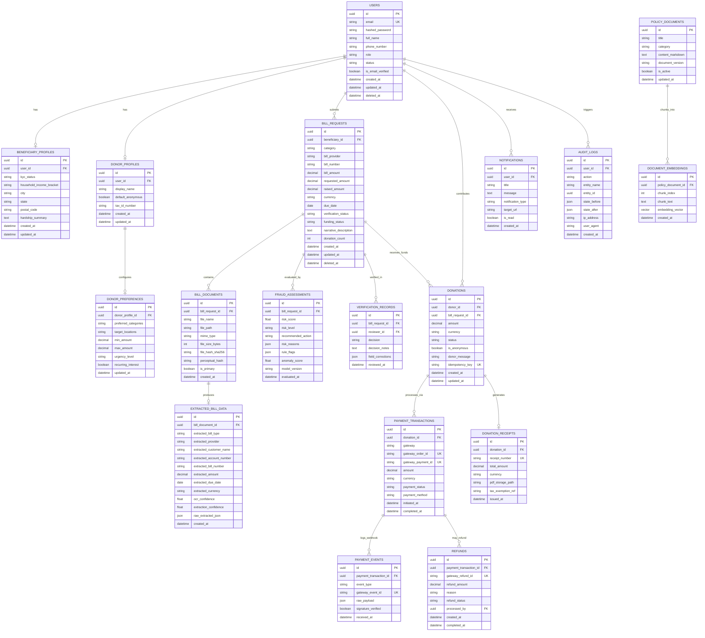

# Database Architecture & Entity-Relationship Specification
## Project Name: BillKind AI
### AI-Powered Essential Bills Crowdfunding & Financial Assistance Platform
**Document Version:** 1.0.0  
**Status:** Approved for Implementation (Phase 1 Deliverable)  
**Date:** November 2026  

---

## 1. Database Overview & Design Principles

The BillKind AI persistence layer is built on **PostgreSQL 16** with the **`pgvector`** extension for similarity embeddings, using **SQLAlchemy 2.0 (Async)** as the Object-Relational Mapper and **Alembic** for schema migrations.

### Core Persistence Invariants
1. **Universally Unique Primary Keys:** All tables use `UUIDv4` primary keys to prevent sequence enumeration attacks and IDOR vulnerabilities.
2. **Double-Entry Financial Ledgers & Auditing:** No monetary value is altered without an immutable corresponding entry in `payment_transactions` and `payment_events`.
3. **Pessimistic Concurrency Control:** Crowdfunding balance updates (`raised_amount`) require database row locks (`SELECT ... FOR UPDATE`) to guarantee zero overfunding.
4. **Data Minimization & Temporal Auditing:** Every table includes `created_at` and `updated_at` timestamps in UTC. Sensitive records support soft-deletion (`is_deleted` and `deleted_at`) while retaining foreign key integrity for financial audits.
5. **Vector Search Acceleration:** Semantic embeddings for policy documents and bill summaries are indexed using HNSW (Hierarchical Navigable Small World) with cosine distance metrics.

---

## 2. Complete Mermaid Entity-Relationship (ER) Diagram

---

## 3. Detailed Table Schema Definitions

### 3.1 Core Authentication & Profile Tables

#### 1. `users`
- `id` (UUID, PK, default `gen_random_uuid()`): Unique identifier.
- `email` (VARCHAR(255), UNIQUE, NOT NULL, INDEX): Lowercase email.
- `hashed_password` (VARCHAR(255), NOT NULL): Argon2id / bcrypt hash.
- `full_name` (VARCHAR(150), NOT NULL): Legal full name.
- `phone_number` (VARCHAR(20), NULL): E.164 formatted phone.
- `role` (VARCHAR(20), NOT NULL, DEFAULT `'beneficiary'`): Enum: `beneficiary`, `donor`, `admin`.
- `status` (VARCHAR(20), NOT NULL, DEFAULT `'active'`): Enum: `active`, `suspended`, `pending_verification`.
- `is_email_verified` (BOOLEAN, DEFAULT FALSE).
- `created_at` (TIMESTAMPTZ, NOT NULL, DEFAULT `now()`).
- `updated_at` (TIMESTAMPTZ, NOT NULL, DEFAULT `now()`).
- `deleted_at` (TIMESTAMPTZ, NULL): Soft delete timestamp.

#### 2. `beneficiary_profiles`
- `id` (UUID, PK): Unique profile ID.
- `user_id` (UUID, FK -> `users.id`, UNIQUE, NOT NULL): 1-to-1 link.
- `kyc_status` (VARCHAR(20), DEFAULT `'pending'`): Enum: `pending`, `verified`, `rejected`.
- `household_income_bracket` (VARCHAR(50), NULL).
- `city` (VARCHAR(100), NOT NULL).
- `state` (VARCHAR(100), NOT NULL).
- `postal_code` (VARCHAR(20), NOT NULL).
- `hardship_summary` (TEXT, NULL): Beneficiary circumstances.
- `created_at`, `updated_at` (TIMESTAMPTZ).

#### 3. `donor_profiles`
- `id` (UUID, PK): Unique profile ID.
- `user_id` (UUID, FK -> `users.id`, UNIQUE, NOT NULL).
- `display_name` (VARCHAR(100), NULL): Public display handle.
- `default_anonymous` (BOOLEAN, DEFAULT FALSE): Anonymity flag.
- `tax_id_number` (VARCHAR(50), NULL): Optional PAN/Tax ID for 80G receipts.
- `created_at`, `updated_at` (TIMESTAMPTZ).

#### 4. `donor_preferences`
- `id` (UUID, PK): Unique preferences ID.
- `donor_profile_id` (UUID, FK -> `donor_profiles.id`, UNIQUE, NOT NULL).
- `preferred_categories` (VARCHAR(255), NULL): Comma-separated or JSON list.
- `target_locations` (VARCHAR(255), NULL): Preferred states or cities.
- `min_amount` (DECIMAL(12,2), DEFAULT 100.00).
- `max_amount` (DECIMAL(12,2), DEFAULT 50000.00).
- `urgency_level` (VARCHAR(20), DEFAULT `'any'`): Enum: `any`, `urgent`, `critical`.
- `recurring_interest` (BOOLEAN, DEFAULT FALSE).
- `updated_at` (TIMESTAMPTZ).

---

### 3.2 Bill Management & Verification Tables

#### 5. `bill_requests`
- `id` (UUID, PK): Unique bill request ID.
- `beneficiary_id` (UUID, FK -> `users.id`, NOT NULL, INDEX): Creator.
- `category` (VARCHAR(50), NOT NULL, INDEX): Enum: `electricity`, `water`, `medical`, `education`, `rent`, `other`.
- `bill_provider` (VARCHAR(150), NOT NULL): Name of issuing authority.
- `bill_number` (VARCHAR(100), NOT NULL, INDEX): Provider invoice number.
- `bill_amount` (DECIMAL(12,2), NOT NULL): Gross amount due.
- `requested_amount` (DECIMAL(12,2), NOT NULL): Requested crowd assistance.
- `raised_amount` (DECIMAL(12,2), NOT NULL, DEFAULT 0.00): Current sum of completed donations.
- `currency` (VARCHAR(3), NOT NULL, DEFAULT `'INR'`).
- `due_date` (DATE, NOT NULL, INDEX): Payment deadline.
- `verification_status` (VARCHAR(30), NOT NULL, DEFAULT `'submitted'`, INDEX): Enum: `draft`, `submitted`, `extracting`, `extracted`, `under_review`, `verified`, `rejected`, `withdrawn`.
- `funding_status` (VARCHAR(30), NOT NULL, DEFAULT `'unfunded'`, INDEX): Enum: `unfunded`, `partially_funded`, `fully_funded`, `expired`, `closed`.
- `narrative_description` (TEXT, NOT NULL): Context and need description.
- `donation_count` (INTEGER, NOT NULL, DEFAULT 0).
- `created_at`, `updated_at`, `deleted_at` (TIMESTAMPTZ).
- *Constraint:* `CHECK (raised_amount <= requested_amount)` - prevents overfunding.
- *Constraint:* `CHECK (requested_amount <= bill_amount)`.

#### 6. `bill_documents`
- `id` (UUID, PK): Unique document record.
- `bill_request_id` (UUID, FK -> `bill_requests.id`, NOT NULL, INDEX).
- `file_name` (VARCHAR(255), NOT NULL): Original filename.
- `file_path` (VARCHAR(500), NOT NULL): Private object storage key.
- `mime_type` (VARCHAR(100), NOT NULL): `application/pdf`, `image/png`, `image/jpeg`.
- `file_size_bytes` (INTEGER, NOT NULL).
- `file_hash_sha256` (VARCHAR(64), NOT NULL, INDEX): Cryptographic SHA-256 hash.
- `perceptual_hash` (VARCHAR(64), NULL, INDEX): Perceptual hash for image visual similarity.
- `is_primary` (BOOLEAN, DEFAULT TRUE).
- `created_at` (TIMESTAMPTZ, DEFAULT `now()`).

#### 7. `extracted_bill_data`
- `id` (UUID, PK).
- `bill_document_id` (UUID, FK -> `bill_documents.id`, UNIQUE, NOT NULL).
- `extracted_bill_type` (VARCHAR(50), NULL).
- `extracted_provider` (VARCHAR(150), NULL).
- `extracted_customer_name` (VARCHAR(150), NULL).
- `extracted_account_number` (VARCHAR(100), NULL).
- `extracted_bill_number` (VARCHAR(100), NULL).
- `extracted_amount` (DECIMAL(12,2), NULL).
- `extracted_due_date` (DATE, NULL).
- `extracted_currency` (VARCHAR(3), DEFAULT `'INR'`).
- `ocr_confidence` (FLOAT, NOT NULL): Range 0.0 - 1.0.
- `extraction_confidence` (FLOAT, NOT NULL): Range 0.0 - 1.0.
- `raw_extracted_json` (JSONB, NOT NULL): Full structured extraction payload.
- `created_at` (TIMESTAMPTZ, DEFAULT `now()`).

#### 8. `fraud_assessments`
- `id` (UUID, PK).
- `bill_request_id` (UUID, FK -> `bill_requests.id`, NOT NULL, INDEX).
- `risk_score` (FLOAT, NOT NULL, INDEX): 0.00 to 1.00.
- `risk_level` (VARCHAR(20), NOT NULL, INDEX): `low`, `medium`, `high`.
- `recommended_action` (VARCHAR(30), NOT NULL): `auto_proceed`, `manual_review`, `escalate`.
- `risk_reasons` (JSONB, NOT NULL): List of explainable strings.
- `rule_flags` (JSONB, NOT NULL): Key-value flags from rule engine.
- `anomaly_score` (FLOAT, NOT NULL): Isolation Forest score.
- `model_version` (VARCHAR(50), NOT NULL): e.g., `rf-v1.0.0-xgb-v1.0.0`.
- `evaluated_at` (TIMESTAMPTZ, DEFAULT `now()`).

#### 9. `verification_records`
- `id` (UUID, PK).
- `bill_request_id` (UUID, FK -> `bill_requests.id`, NOT NULL, INDEX).
- `reviewer_id` (UUID, FK -> `users.id`, NOT NULL): Admin reviewer.
- `decision` (VARCHAR(30), NOT NULL): `approved`, `rejected`, `corrections_requested`.
- `decision_notes` (TEXT, NULL): Rationale provided by reviewer.
- `field_corrections` (JSONB, NULL): Admin overrides for extracted fields.
- `reviewed_at` (TIMESTAMPTZ, DEFAULT `now()`).

---

### 3.3 Payments, Ledgers & Receipts Tables

#### 10. `donations`
- `id` (UUID, PK).
- `donor_id` (UUID, FK -> `users.id`, NOT NULL, INDEX): Donor.
- `bill_request_id` (UUID, FK -> `bill_requests.id`, NOT NULL, INDEX).
- `amount` (DECIMAL(12,2), NOT NULL): Contribution amount.
- `currency` (VARCHAR(3), NOT NULL, DEFAULT `'INR'`).
- `status` (VARCHAR(20), NOT NULL, DEFAULT `'pending'`, INDEX): `pending`, `completed`, `failed`, `refunded`.
- `is_anonymous` (BOOLEAN, DEFAULT FALSE).
- `donor_message` (TEXT, NULL): Kind note to the beneficiary.
- `idempotency_key` (VARCHAR(100), UNIQUE, NOT NULL): Client-generated idempotency token.
- `created_at`, `updated_at` (TIMESTAMPTZ).

#### 11. `payment_transactions`
- `id` (UUID, PK).
- `donation_id` (UUID, FK -> `donations.id`, NOT NULL, INDEX).
- `gateway` (VARCHAR(50), NOT NULL): `razorpay`, `stripe`, `mock`.
- `gateway_order_id` (VARCHAR(100), UNIQUE, NOT NULL, INDEX): e.g. `order_M12345`.
- `gateway_payment_id` (VARCHAR(100), UNIQUE, NULL, INDEX): e.g. `pay_N67890`.
- `amount` (DECIMAL(12,2), NOT NULL).
- `currency` (VARCHAR(3), NOT NULL, DEFAULT `'INR'`).
- `payment_status` (VARCHAR(30), NOT NULL, DEFAULT `'created'`, INDEX): `created`, `authorized`, `captured`, `failed`, `refunded`.
- `payment_method` (VARCHAR(50), NULL): e.g. `upi`, `card`, `netbanking`.
- `initiated_at` (TIMESTAMPTZ, DEFAULT `now()`).
- `completed_at` (TIMESTAMPTZ, NULL).

#### 12. `payment_events`
- `id` (UUID, PK).
- `payment_transaction_id` (UUID, FK -> `payment_transactions.id`, NULL, INDEX).
- `event_type` (VARCHAR(100), NOT NULL): Webhook event name (e.g. `order.paid`, `payment.captured`).
- `gateway_event_id` (VARCHAR(100), UNIQUE, NOT NULL, INDEX): Gateway event identifier.
- `raw_payload` (JSONB, NOT NULL): Complete received JSON body.
- `signature_verified` (BOOLEAN, NOT NULL, DEFAULT FALSE).
- `received_at` (TIMESTAMPTZ, DEFAULT `now()`).

#### 13. `refunds`
- `id` (UUID, PK).
- `payment_transaction_id` (UUID, FK -> `payment_transactions.id`, NOT NULL, INDEX).
- `gateway_refund_id` (VARCHAR(100), UNIQUE, NULL): External refund reference.
- `refund_amount` (DECIMAL(12,2), NOT NULL).
- `reason` (VARCHAR(255), NOT NULL).
- `refund_status` (VARCHAR(30), NOT NULL, DEFAULT `'pending'`): `pending`, `processed`, `failed`.
- `processed_by` (UUID, FK -> `users.id`, NOT NULL): Admin user who authorized refund.
- `created_at`, `completed_at` (TIMESTAMPTZ).

#### 14. `donation_receipts`
- `id` (UUID, PK).
- `donation_id` (UUID, FK -> `donations.id`, UNIQUE, NOT NULL).
- `receipt_number` (VARCHAR(50), UNIQUE, NOT NULL, INDEX): e.g. `BB-RCP-2026-000491`.
- `total_amount` (DECIMAL(12,2), NOT NULL).
- `currency` (VARCHAR(3), NOT NULL, DEFAULT `'INR'`).
- `pdf_storage_path` (VARCHAR(500), NOT NULL): Storage key for the generated PDF.
- `tax_exemption_ref` (VARCHAR(100), NULL): Section 80G registration reference.
- `issued_at` (TIMESTAMPTZ, DEFAULT `now()`).

---

### 3.4 Operational, Audit & AI Knowledge Tables

#### 15. `notifications`
- `id` (UUID, PK).
- `user_id` (UUID, FK -> `users.id`, NOT NULL, INDEX).
- `title` (VARCHAR(150), NOT NULL).
- `message` (TEXT, NOT NULL).
- `notification_type` (VARCHAR(50), NOT NULL): `bill_verified`, `donation_received`, `goal_reached`, `system`.
- `target_url` (VARCHAR(255), NULL).
- `is_read` (BOOLEAN, DEFAULT FALSE, INDEX).
- `created_at` (TIMESTAMPTZ, DEFAULT `now()`).

#### 16. `audit_logs`
- `id` (UUID, PK).
- `user_id` (UUID, FK -> `users.id`, NULL, INDEX): Performing actor.
- `action` (VARCHAR(100), NOT NULL, INDEX): `BILL_APPROVED`, `REFUND_ISSUED`, `USER_SUSPENDED`.
- `entity_name` (VARCHAR(50), NOT NULL, INDEX): Target table name.
- `entity_id` (UUID, NOT NULL, INDEX): Target row primary key.
- `state_before` (JSONB, NULL): Previous snapshot.
- `state_after` (JSONB, NULL): New snapshot.
- `ip_address` (VARCHAR(45), NULL): Client IPv4 or IPv6.
- `user_agent` (VARCHAR(255), NULL).
- `created_at` (TIMESTAMPTZ, DEFAULT `now()`, INDEX).

#### 17. `policy_documents`
- `id` (UUID, PK).
- `title` (VARCHAR(200), NOT NULL).
- `category` (VARCHAR(50), NOT NULL): `eligibility`, `verification_policy`, `refund_rules`, `security`.
- `content_markdown` (TEXT, NOT NULL): Full authoritative policy text.
- `document_version` (VARCHAR(20), NOT NULL, DEFAULT `'1.0'`).
- `is_active` (BOOLEAN, DEFAULT TRUE).
- `updated_at` (TIMESTAMPTZ, DEFAULT `now()`).

#### 18. `document_embeddings`
- `id` (UUID, PK).
- `policy_document_id` (UUID, FK -> `policy_documents.id`, NOT NULL, INDEX).
- `chunk_index` (INTEGER, NOT NULL).
- `chunk_text` (TEXT, NOT NULL): Text segment (300-500 tokens).
- `embedding_vector` (vector(384), NOT NULL): Sentence Transformer `all-MiniLM-L6-v2` embedding.
- `created_at` (TIMESTAMPTZ, DEFAULT `now()`).
- *Index:* `CREATE INDEX idx_embeddings_hnsw ON document_embeddings USING hnsw (embedding_vector vector_cosine_ops)`.

---
*End of Database Architecture Specification*
